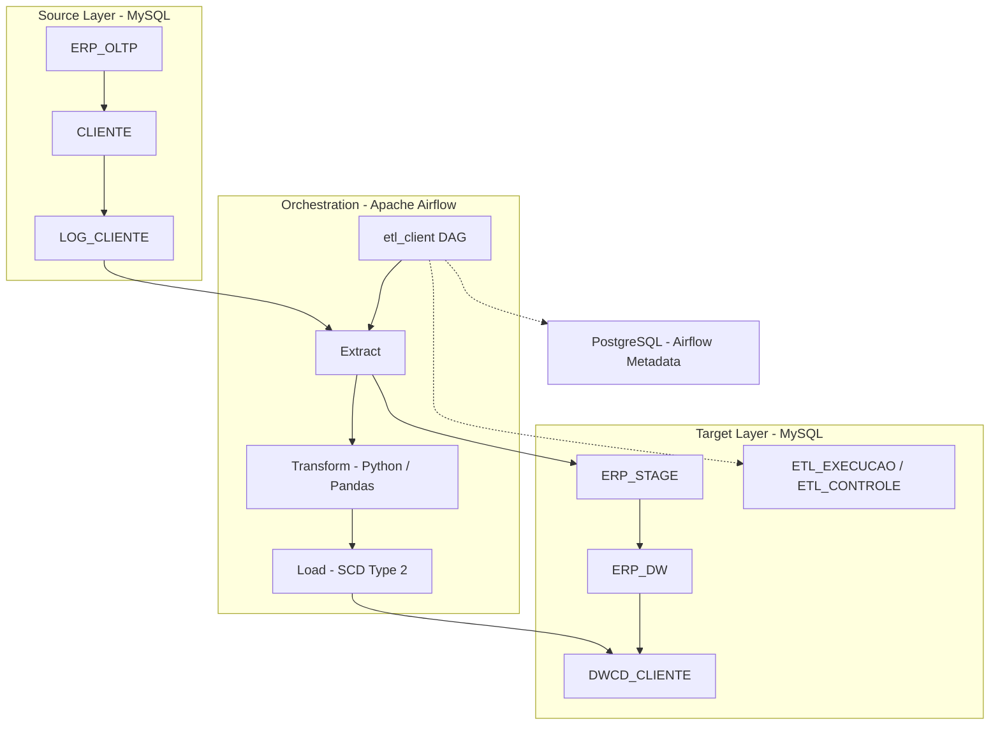

# Apache Airflow — Incremental ETL Pipeline

An end-to-end Data Engineering portfolio project that demonstrates how to orchestrate an incremental ETL pipeline using **Apache Airflow 3**, **Python**, **Pandas**, **MySQL**, **PostgreSQL** and **Docker Compose**.

The pipeline captures customer changes from a MySQL operational database, stages and transforms the data, and loads a Data Warehouse while preserving historical versions using **Slowly Changing Dimension Type 2 (SCD Type 2)**.

## Project Overview

This project simulates a customer data integration scenario and demonstrates:

- ETL orchestration with Apache Airflow.
- Change tracking in a MySQL OLTP database using triggers.
- Incremental extraction based on a persisted watermark.
- Data transformation with Python and Pandas.
- Separation of OLTP, staging and Data Warehouse layers.
- Historical data management with SCD Type 2.
- ETL execution logging and incremental load control.
- Containerized services managed with Docker Compose.

## Architecture

The solution separates source data, orchestration, analytical storage and Airflow metadata.



### Database Layers

| Database | Purpose |
|---|---|
| `ERP_OLTP` | Operational source database containing customer records and change logs. |
| `ERP_STAGE` | Staging area used to prepare extracted customer data. |
| `ERP_DW` | Data Warehouse containing the customer dimension and ETL control tables. |
| PostgreSQL | Stores Airflow metadata, separate from the project's MySQL databases. |

## ETL Workflow

The `etl_client` DAG orchestrates the customer pipeline through the following stages:

1. **Start Execution** — registers the beginning of an ETL run.
2. **Prepare Staging** — clears the staging table before loading the current batch.
3. **Extract** — reads customer changes recorded in `LOG_CLIENTE`.
4. **Transform** — standardizes and enriches extracted data using Python and Pandas.
5. **Load** — applies changes to `DWCD_CLIENTE`, preserving history with SCD Type 2.
6. **Finish Execution** — records the final status and updates the incremental checkpoint after a successful run.

## Incremental Data Loading

The pipeline uses two control tables in `ERP_DW`.

### ETL_EXECUCAO

Stores the execution history, including:

- Process name.
- Start and end timestamps.
- Execution status.
- Error message, when applicable.

### ETL_CONTROLE

Stores the last successful load timestamp for each ETL process.

The `DT_ULTIMA_CARGA` field acts as the watermark used to identify new or modified records in `LOG_CLIENTE`.

The watermark is advanced only after a successful execution. This prevents a failed run from moving the extraction checkpoint forward and skipping changes on the next attempt.

## Historical Data — SCD Type 2

The `DWCD_CLIENTE` dimension keeps previous versions of customer records instead of simply overwriting them.

| Field | Description |
|---|---|
| `IDSK` | Surrogate key identifying a dimension version. |
| `IDCLIENTE` | Business key from the operational database. |
| `INICIO` | Timestamp when the version becomes valid. |
| `FIM` | Timestamp when the version expires. |

When a tracked attribute changes:

1. The current version is closed by setting its `FIM` timestamp.
2. A new version is inserted with the updated information.
3. Previous versions remain available for historical analysis.

A row with `FIM IS NULL` represents the current version.

## Technology Stack

| Technology | Purpose |
|---|---|
| Apache Airflow 3.3.2 | Workflow orchestration |
| Python 3.12 | ETL development |
| Pandas | Data transformation |
| SQLAlchemy | Database connectivity and ORM |
| PyMySQL | MySQL driver |
| MySQL 8.4 | OLTP, staging and Data Warehouse |
| PostgreSQL 16 | Airflow metadata database |
| Docker | Containerization |
| Docker Compose | Local environment orchestration |

## Repository Structure

```text
.
├── airflow/
│   └── dags/
│       ├── config/
|       |   |__ __init__.py
│       │   └── database.py
│       ├── models/
|       |   |__ __init__.py
│       │   └── database_models.py
│       ├── services/
|       |   |__ __init__.py
│       │   └── cliente.py
│       ├── CLIENTES_ESTADOS.xlsx
│       └── etl_client.py
├── mysql-init/
│   └── 02-grants.sh
├── Dockerfile
├── docker-compose.yml
├── setup.sql
├── .env-example
└── README.md
```

### Main Components

| File / Directory | Responsibility |
|---|---|
| `airflow/dags/etl_client.py` | Defines the Airflow DAG and task dependencies. |
| `airflow/dags/services/cliente.py` | Implements customer extraction, transformation, loading and execution tracking. |
| `airflow/dags/config/database.py` | Configures database connections. |
| `airflow/dags/models/database_models.py` | Defines database models. |
| `CLIENTES_ESTADOS.xlsx` | Geographic reference data used during data enrichment. |
| `setup.sql` | Creates MySQL databases, tables, triggers and sample source data. |
| `mysql-init/` | Contains MySQL initialization support scripts. |
| `Dockerfile` | Builds the custom Airflow image and installs DAG dependencies. |
| `docker-compose.yml` | Defines Airflow, PostgreSQL and MySQL services. |
| `.env-example` | Template containing the environment variables required to configure the project. |

## Getting Started

### Prerequisites

Before running the project, make sure you have installed:

- Git
- Docker Desktop (Windows/macOS) or Docker Engine (Linux)
- Docker Compose v2

### 1. Clone the repository

```bash
git clone https://github.com/dlinoba/Airflow.git

cd Airflow
```

### 2. Configure Environment Variables

Create your local `.env` file from the provided example.

**Linux / macOS / Git Bash**

```bash
cp .env-example .env
```

**Windows PowerShell**

```powershell
Copy-Item .env-example .env
```

Open `.env` and replace the example passwords with your own values.

The `.env-example` template contains:

```dotenv
MYSQL_ROOT_PASSWORD=password
MYSQL_DATABASE=ERP_OLTP

MYSQL_USER=user
MYSQL_PASSWORD=password

AIRFLOW_USERNAME=admin
AIRFLOW_PASSWORD=password
AIRFLOW_EMAIL=admin@example.com.br

POSTGRES_USER=admin
POSTGRES_PASSWORD=password
```

The Docker Compose configuration uses `airflow` as the default PostgreSQL database name when `POSTGRES_DB` is not provided.

**Important:** Never commit your local `.env` file or real credentials to GitHub. The `.env-example` file should contain only placeholder values.

### 3. Build and Start the Environment

Run:

```bash
docker compose up -d --build
```

Check the running containers:

```bash
docker compose ps
```

### 4. Access Apache Airflow

Open the following URL in your browser:

[http://localhost:8080](http://localhost:8080)

Sign in using the `AIRFLOW_USERNAME` and `AIRFLOW_PASSWORD` values configured in your local `.env` file.

Find the `etl_client` DAG and trigger a manual execution to test the pipeline.

### 5. Useful Docker Commands

```bash
# Check container status
docker compose ps

# Follow logs from all services
docker compose logs -f

# Follow Airflow scheduler logs
docker compose logs -f airflow-scheduler

# Stop services without deleting persistent data
docker compose down

# Rebuild and start services
docker compose up -d --build
```

### Database Initialization

The MySQL service maps `setup.sql` and the scripts in `mysql-init/` to the container's initialization directory.

MySQL executes these initialization scripts when its data directory is initialized for the first time.

If the MySQL data directory already exists, changes to `setup.sql` or initialization scripts will not automatically be executed again.

Be careful when resetting the database: deleting its persisted data also deletes the databases stored there.

## Testing the ETL Pipeline

The initialization script creates sample customer records in `ERP_OLTP.CLIENTE`.

You can simulate source changes using SQL statements such as:

```sql
-- Insert a new customer
INSERT INTO ERP_OLTP.CLIENTE
    (NOME, SOBRENOME, EMAIL, SEXO, NASCIMENTO)
VALUES
    ('Teste', 'Teste', 'teste@teste.com.br', 'M', '2000-03-10');

-- Update an existing customer
UPDATE ERP_OLTP.CLIENTE
SET NOME = 'Kaio'
WHERE IDCLIENTE = 10;
```

The source table triggers record insert, update and delete operations in `LOG_CLIENTE`.

After modifying the source data:

1. Open the Airflow interface.
2. Locate the `etl_client` DAG.
3. Trigger a new execution.
4. Monitor the task execution.
5. Verify the results in the Data Warehouse.

### Example Validation Queries

```sql
-- ETL execution history
SELECT *
FROM ERP_DW.ETL_EXECUCAO
ORDER BY ID_EXECUCAO DESC;

-- Incremental load control
SELECT *
FROM ERP_DW.ETL_CONTROLE;

-- Customer historical records
SELECT *
FROM ERP_DW.DWCD_CLIENTE
WHERE IDCLIENTE = 10
ORDER BY INICIO;
```

For customers with historical changes, previous dimension versions should have their `FIM` timestamps populated, while the current version should have `FIM IS NULL`.

## Project Scope

This project was developed as a practical Data Engineering portfolio project to demonstrate:

- ETL pipeline development.
- Workflow orchestration.
- Incremental data processing.
- Data transformation and standardization.
- Database modeling.
- Data Warehouse implementation.
- Historical data management with SCD Type 2.
- ETL execution monitoring.
- Docker-based development environments.

The current implementation focuses on demonstrating these concepts in a local environment. Additional security hardening, automated testing, observability and infrastructure improvements would be necessary before production deployment.

## Author

**Deyvid Linoba**

Data Engineering | Business Intelligence | Data Analytics

- GitHub: [@dlinoba](https://github.com/dlinoba)
- LinkedIn: [deyvid-linoba](https://www.linkedin.com/in/deyvid-linoba/)